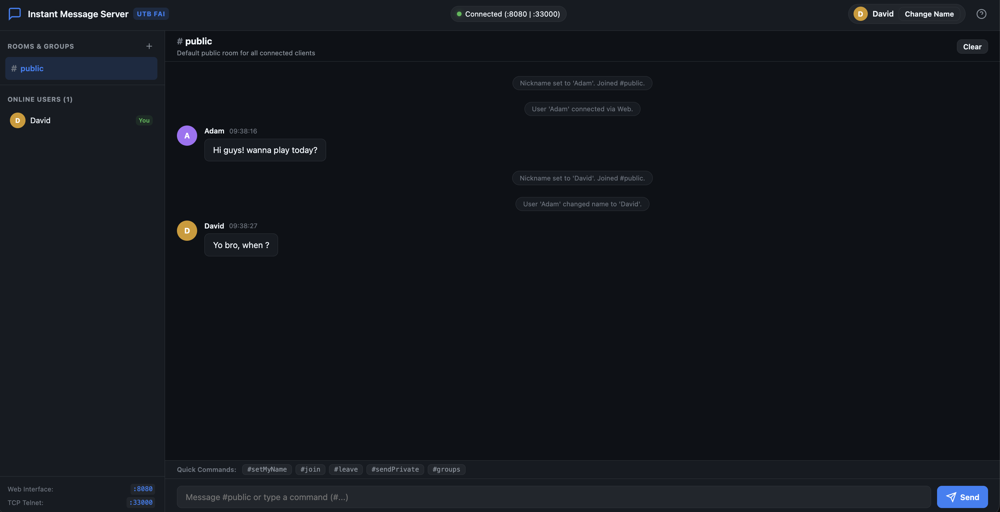

   

# IM Server GUI

Web-based interface for the Instant Message Server from Assignment 4 with real-time WebSocket communication and concurrent TCP Telnet client support.

## Tech Stack

- **Java 17+**
- **Spring Boot 4** (Spring Web, Spring WebSocket)
- **Vanilla JavaScript** (native WebSocket API)
- **Pure CSS3** (no Tailwind, Bootstrap, or build pipelines)

## Requirements

- Java JDK 17+
- Modern web browser
- Optional: `nc` or `telnet` for terminal testing

## How to Run

**Gradle (Development)**
1. Navigate to the project directory:
   ```bash
   cd im-server-gui
   ```
2. Start the application:
   ```bash
   ./gradlew bootRun
   ```
3. Open `http://localhost:8080` in your browser.

**Standalone JAR**
1. Build the archive:
   ```bash
   ./gradlew build
   ```
2. Run the JAR:
   ```bash
   java -jar build/libs/im-server-gui-0.0.1-SNAPSHOT.jar
   ```
3. Open `http://localhost:8080` in your browser.

**Terminal Client (Optional)**
1. In a separate terminal window, connect to the TCP port:
   ```bash
   nc localhost 33000
   ```
   or:
   ```bash
   telnet localhost 33000
   ```
2. Enter your nickname when prompted (`Enter your name:`).
3. Send broadcast messages or commands (`#join dev`, `#sendPrivate WebUser hello`). Messages synchronize with the web interface in real time.

**Run Tests**
```bash
./gradlew test
```

## Structure

```
im-server-gui/
├── src/
│   ├── main/
│   │   ├── java/utb/fai/
│   │   │   ├── ActiveHandlers.java          
│   │   │   ├── ClientSession.java           
│   │   │   ├── ImServerGuiApplication.java  
│   │   │   ├── TcpClientSession.java        
│   │   │   ├── TcpServerService.java        
│   │   │   ├── WebSocketChatHandler.java    
│   │   │   ├── WebSocketClientSession.java  
│   │   │   └── WebSocketConfig.java         
│   │   └── resources/
│   │       ├── application.properties       
│   │       └── static/
│   │           ├── css/
│   │           │   └── style.css            
│   │           ├── js/
│   │           │   └── app.js               
│   │           └── index.html               
│   └── test/
│       └── java/utb/fai/
│           └── ImServerGuiApplicationTests.java 
├── build.gradle                            
├── gradlew                                 
└── README.md
```

## License

Made with Java by <a href="https://github.com/adamstefanik">Adam Samuel Štefánik</a>.
